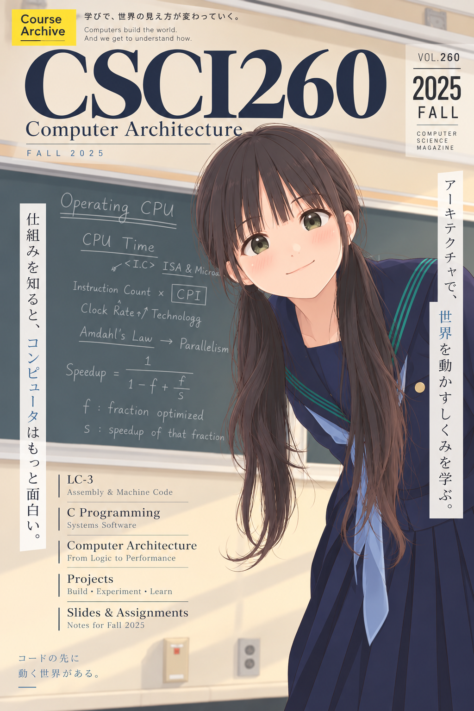

# :octicons-cpu-16: Introduction

Welcome to your first step into Computer Architecture!

**[Explore the course materials library](library/index.md)** to follow the Fall25 chapter sequence with earlier lectures and exercises placed alongside it. Start with the reading map, or go directly to [assignments and projects](library/assignments.md). Check the [known corrections](library/errata.md) when using the archived slides.

<figure>
  
  <figcaption>CSCI 260 · Fall 2025 course archive</figcaption>
</figure>

The online material you are about to see will help you bridging the gap between hardware and software's side. I believe these information would help you to reveil the cooperation between our daily magic (programs) today, and the carrier(computer chips) to make those magic happen.

## What are these materials for?

This part of Computer Architecture is focusing on the user's side, touching the programming system to the assembly, and machine code. The machine code we are using is called Little Computer - 3, or LC-3, a commonly used architecture in the United States' colleges. The programming system's side is in C language (C89). We will be talking mostly a 'professional user' would like to know. So you will be able to:

* Pick the correct hardware wisely.
* Know your bottleneck is on the software side or hardware side.
* Describe the whole workflow of programming, from code to machine to application.
* Write machine code and assembly; and debug with these codes.
* Understand the tachnologies in hottest areas, like Ray Tracing, Neural Network Accelerators, System-on-Chip, etc.
* Know your next step if you want to dig further in the field.

Notice the Level 0 is nothing about rankings, it is just different stories of a building. If you need something deeper than ISA and want to explore the psysical layer by trying build a computer chip with Hardware Description Language, like VHDL, verilog, or systemC, you need to move down a story; if you want to know more about the connections between machine code, assembly, and your high level language, you might have to move up a story; but spoil alert, compilers is in another building.

## Can I have a big picture on the material?

Transformed from my lecture in the university, the material contains basic structure to set up a regular college course, which mean you will have slides, notes, assignments, projects, historical tests, and supplementaries.

But on the other hand, I'm packing up resources, blogs, or materials from my friends in the industry and academia, to make the contents connected and comprehensive.

## I want to make suggestions, alternations, or I found mistakes...

Feel free to send me emails or shoot issues on github page.
I'm happy to take refinements and I'm looking forward to complete this with all of you.

## I know you somehow merely at broke. Can I buy you a cup of coffee?

Thank you for noticing that. I'm still figuring out how to do this... I'll let you know once I'm ready.

## My special thanks...

I would like to thank Professor David Wentzlaff at Princeton to ignite the spark for me to be a professor inspiring people around, and I highly suggest his COS475/ELE475, which is available at Coursera.

I would like to thank Professor David August at Princeton to provide consistant helps for bringing up the insights, so I could bring thoughtful and tested ideas in to my classroom. I also suggest his COS375/ELE375. Those gave me great memories to carry on until today.

I would like to thank Valerie "Siyuan" Feng at Drew to let me practice and examine the material, so I'm getting down to become a better teacher, gradually but steady, through my dark ages.

I would like to thank Arts Suraimu from nVidia to cover the part on parallel/matrix processing unit with newest technologies. Students love that, and I love you sister.

Lastly... I would like to thank b1f6c1c4 to open the gate for me. A lot of distructive things happened throughout these years, but I decide to cherish the good parts, as the good parts of you will be shining in my code in verilog, blinking on my PCBs in the dark, regardless you are fading away. Learn to love is harder than learn to code. I wish you will complete that sooner than later.
